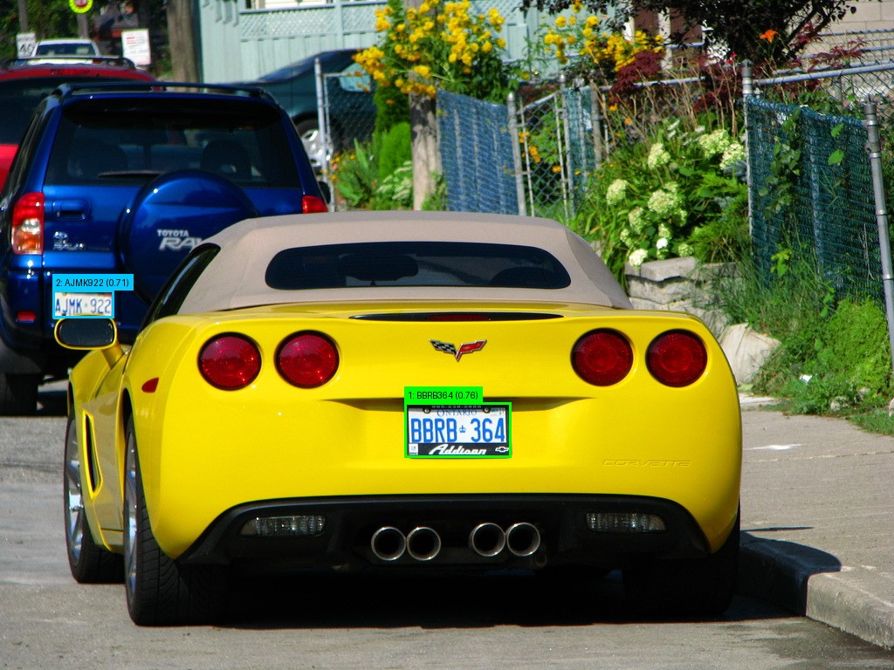
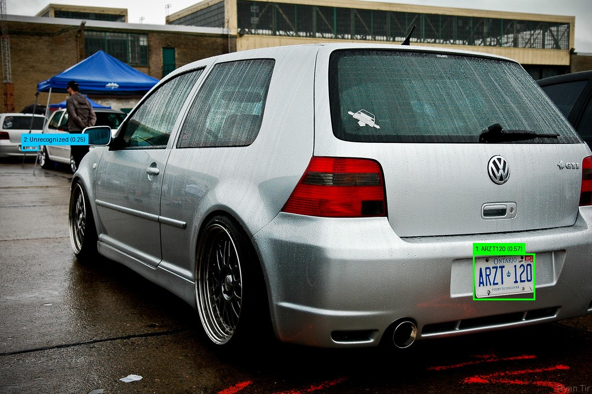
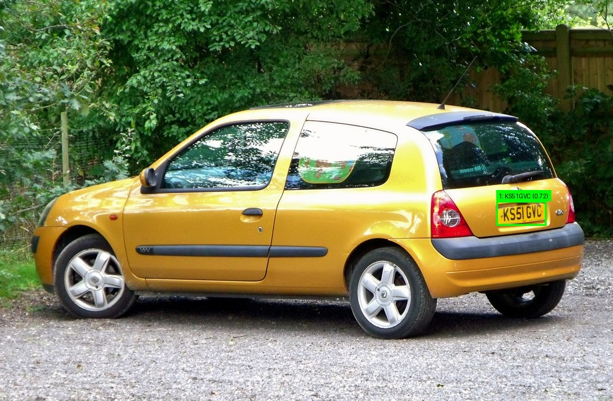
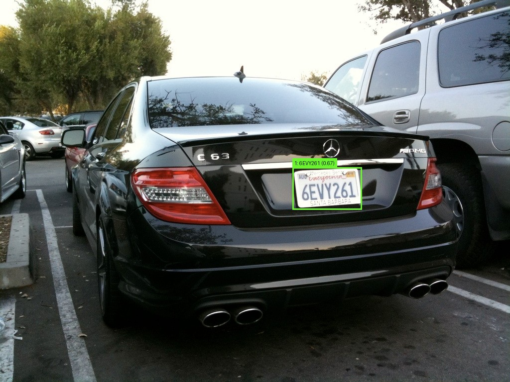
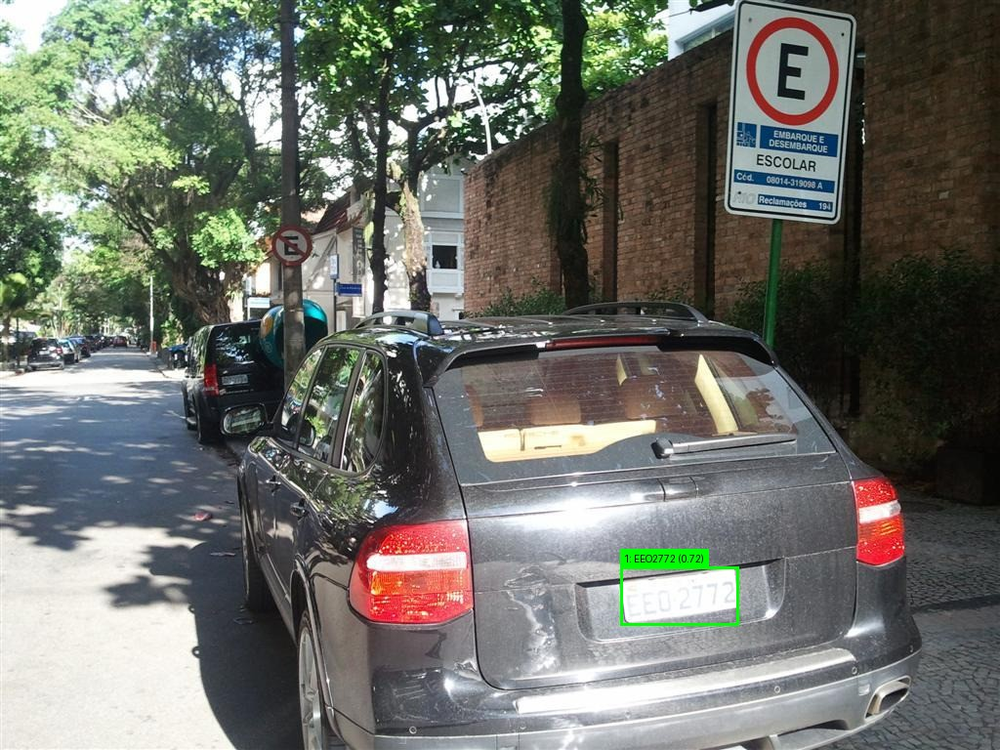
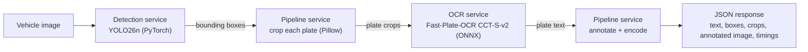

# License Plate Recognition

End-to-end license plate recognition served as an HTTP API. A custom-trained **YOLO26n** detector finds every plate in a vehicle image, each plate is cropped with Pillow, and the pretrained **Fast-Plate-OCR** `cct-s-v2-global-model` reads its text. The pipeline is packaged with **BentoML** and can run from source, as a `.bento` archive, or as a Docker container, on either an **NVIDIA CUDA** GPU or **CPU only**.

<p align="center">
  
</p>

## Table of contents

- [Examples](#examples)
- [How it works](#how-it-works)
- [Results](#results)
- [Quick start](#quick-start)
- [API](#api)
- [Project structure](#project-structure)
- [Development guide](#development-guide)
  - [Environment](#environment)
  - [Detection — YOLO26n](#detection--yolo26n) ([dataset setup](#dataset-setup))
  - [OCR — Fast-Plate-OCR](#ocr--fast-plate-ocr)
  - [BentoML — Export individual models](#bentoml--export-individual-models)
  - [BentoML — Run individual services](#bentoml--run-individual-services)
  - [Complete pipeline](#complete-pipeline)
  - [BentoML — Package the complete pipeline](#bentoml--package-the-complete-pipeline)
- [Useful references](#useful-references)
- [Datasets](#datasets)
- [License](#license)

---

## Examples

Annotated images returned by the pipeline and saved by the [command-line client](#command-line-client). Each box is labeled `<id>: <plate text> (<detection confidence>)`.

| | |
|:---:|:---:|
|  |  |
| **Ontario** — `ARZT120` (0.57). A second, distant plate is detected at 0.25 confidence but too small to read, so it is labeled *Unrecognized*. | **United Kingdom** — `KS51GVC` (0.72) |
|  |  |
| **California** — `6EVY261` (0.67) | **Brazil** — `EEO2772` (0.72) |

The image at the top shows two plates in one image: `BBRB364` (0.76) and `AJMK922` (0.71).

---

## How it works



The project is composed of three BentoML services:

| Service | File | What it does | Runs on |
|---|---|---|---|
| `LicensePlateDetection` | [services/detection_service.py](services/detection_service.py) | Runs the trained YOLO26n detector and returns plate boxes (`xyxy` pixels) with confidences. | GPU when CUDA is available, otherwise CPU |
| `LicensePlateOCR` | [services/ocr_service.py](services/ocr_service.py) | Reads the text of one cropped plate with Fast-Plate-OCR, optionally with per-character confidences. | CPU (ONNX Runtime) |
| `LicensePlatePipeline` | [services/pipeline_service.py](services/pipeline_service.py) | Calls the detector, clamps and crops every box, sends each crop to OCR, draws the results on the image, and returns everything as JSON. | Orchestration only |

Design notes:

- **Failures are isolated per plate.** If a box cannot be cropped or OCR fails on one plate, that plate gets a `crop_error` / `ocr_error` field and the rest of the response is still returned, including the crop.
- **Boxes are clamped outward.** Coordinates are floored at the top-left and ceiled at the bottom-right, then clipped to the image, so the crop never cuts off edge pixels.
- **Models live in the BentoML Model Store.** The services load `license_plate_detector:latest` and `license_plate_ocr:latest`; the repository ships both as `.bentomodel` archives in [models/bentoml/](models/bentoml/), so no training or download is needed to run the pipeline.
- **One device choice everywhere.** Every command has a CUDA (`--extra cu130`) and a CPU (`--extra cpu`) variant, and the deployable Bento/Docker image is built per device from `bentofile.cu130.yaml` or `bentofile.cpu.yaml`.

---

## Results

**Detection** — YOLO26n, 640 px, evaluated on the held-out test split of the Large License Plate Detection Dataset:

| Precision | Recall | mAP50 | mAP75 | mAP50-95 |
|---:|---:|---:|---:|---:|
| 0.9261 | 0.8814 | 0.9142 | 0.7982 | 0.6795 |

**OCR** — pretrained `cct-s-v2-global-model` on 206 cropped Brazilian plates, CPU inference: **94.17%** exact plate accuracy, **1.46%** character error rate, **25.46 ms** mean inference time. See [Evaluate the Brazilian OCR dataset](#evaluate-the-brazilian-ocr-dataset) for the full table.

These are results on the evaluated datasets and configurations; they are not a guarantee of performance on other data.

---

## Quick start

Run the complete pipeline from a fresh clone, using the models committed to the repository.

### Requirements

- Windows with Python **3.13** and [uv](https://docs.astral.sh/uv/). The `uv` lockfile is resolved for Windows only.
- For GPU inference: an NVIDIA GPU with a driver that supports CUDA 13.0.
- For containers only: Docker Desktop with Linux containers.

Datasets are **not** needed to run the pipeline; they are only used for training and evaluation.

### 1. Install the environment

Choose the device for this machine:

```powershell
# Desktop — NVIDIA CUDA
uv sync --extra cu130 --locked

# Laptop — CPU
uv sync --extra cpu --locked
```

### 2. Import the models into the local BentoML Model Store

```powershell
uv run --extra cu130 bentoml models import .\models\bentoml\license_plate_detector.bentomodel
uv run --extra cu130 bentoml models import .\models\bentoml\license_plate_ocr.bentomodel
```

Use `--extra cpu` instead of `--extra cu130` on a CPU machine (the same applies to every command below).

### 3. Start the pipeline service

```powershell
uv run --extra cu130 bentoml serve services.pipeline_service:LicensePlatePipeline
```

The API listens on `http://localhost:3000`. Opening that address in a browser shows BentoML's interactive API page, where you can upload an image to `/recognize`.

### 4. Recognize plates in an image

In a second terminal:

```powershell
uv run --extra cu130 license-plate-recognition "path\to\vehicle.jpg"
```

Example output (first request after startup, on the CUDA desktop):

```text
Plates detected:        2
Successful recognition: 2
  #1: ADZ79W  (detection 0.69, bbox [789, 348, 831, 372])
  #2: 00371  (detection 0.66, bbox [1, 403, 61, 435])
Server processing time: 3488.5 ms
Outputs saved to:       D:\license-plate-recognition\runs\pipeline\00723dac8201a83e
```

The annotated image, one PNG per plate crop, and `result.json` are saved under `runs/pipeline/<image name>/`. The first request after startup is much slower because the detector initializes CUDA and warms up; later requests are faster. Stop the server with `Ctrl+C`.

### Other ways to run it

- **Prebuilt Bento archive** — import `license_plate_pipeline_cu130.bento` or `license_plate_pipeline_cpu.bento` from [models/bentoml/](models/bentoml/) and serve it; see [Export the complete Bento archive](#export-the-complete-bento-archive).
- **Docker** — build a CUDA or CPU image from the Bento; see [Containerize the Bento with Docker](#containerize-the-bento-with-docker).

---

## API

### `POST /recognize`

| Parameter | Type | Default | Description |
|---|---|---|---|
| `image` | image file | required | Vehicle image. Converted to RGB. |
| `confidence_threshold` | float, 0–1 | `0.25` | Minimum detector confidence. |
| `iou_threshold` | float, 0–1 | `0.7` | Detector NMS IoU threshold. |
| `return_ocr_confidence` | bool | `true` | Include per-character OCR confidences. |

Response from the Quick start example above (abridged: Base64 data and the second detection omitted, confidences rounded):

```json
{
  "image": { "width": 1024, "height": 768, "color_mode": "RGB" },
  "model": { "detector": "YOLO26n", "recognizer": "cct-s-v2-global-model" },
  "parameters": { "confidence_threshold": 0.25, "iou_threshold": 0.7 },
  "detection_count": 2,
  "successful_recognitions": 2,
  "detections": [
    {
      "id": 1,
      "class_id": 0,
      "class_name": "license_plate",
      "detection_confidence": 0.69494,
      "bbox_xyxy": [789, 348, 831, 372],
      "cropped_image": { "mime_type": "image/png", "encoding": "base64", "data": "..." },
      "crop_dimensions": { "width": 42, "height": 24 },
      "plate_text": "ADZ79W",
      "ocr_status": "success",
      "character_confidences": [1.0, 0.983, 1.0, 1.0, 1.0, 0.999, 1.0, 1.0, 1.0, 1.0],
      "region": "United States",
      "region_confidence": 0.848,
      "ocr_time_ms": 62.323
    }
  ],
  "annotated_image": { "mime_type": "image/png", "encoding": "base64", "data": "..." },
  "timings_ms": {
    "detection": 3319.979,
    "cropping": 0.054,
    "crop_encoding": 0.468,
    "ocr": 85.833,
    "annotation": 1.028,
    "annotated_image_encoding": 80.107,
    "total": 3488.525
  }
}
```

- `ocr_status` is `success`, `error` (with `ocr_error`), or `not_run` (with `crop_error`).
- `character_confidences` has one value per OCR output slot (10 for this model), including the padding slots after the last character, so it can be longer than `plate_text`.
- `region` and `region_confidence` are included when the OCR model provides them.

The detector and OCR services can also be served on their own (`/detect` and `/recognize`); see [BentoML — Run individual services](#bentoml--run-individual-services).

---

## Project structure

```text
license-plate-recognition/
├── services/                     # BentoML services
│   ├── detection_service.py      #   YOLO26n detector  → /detect
│   ├── ocr_service.py            #   Fast-Plate-OCR    → /recognize (single crop)
│   └── pipeline_service.py       #   full pipeline     → /recognize
├── src/
│   ├── detection/                # dataset checks, training, evaluation, registration
│   ├── ocr/                      # single-image prediction, evaluation, registration
│   └── license_plate_recognition/
│       └── cli.py                # `license-plate-recognition` command-line client
├── configs/detection.yaml        # YOLO dataset configuration
├── models/bentoml/               # exported .bentomodel and .bento archives
├── docs/images/                  # README example images
├── bentofile.cu130.yaml          # Bento build — NVIDIA CUDA 13.0
├── bentofile.cpu.yaml            # Bento build — CPU only
├── .bentoignore
├── pyproject.toml / uv.lock      # uv project with `cu130` and `cpu` extras
└── yolo26n.pt                    # pretrained YOLO26n weights used as the training starting point
```

Not tracked in Git: `datasets/` (download from the [Datasets](#datasets) links) and `runs/` (training, evaluation, and CLI outputs).

---

# Development guide

The rest of this README collects the commands used to inspect, train, evaluate, serve, and package the license plate recognition pipeline.

The project has two model components:

- **Detection:** custom-trained YOLO26n model using the Large License Plate Detection Dataset.
- **OCR:** pretrained Fast-Plate-OCR `cct-s-v2-global-model`, evaluated on the Brazilian License Plate OCR dataset.

The complete BentoML pipeline runs detection, crops each plate with Pillow, recognizes its text, and returns JSON metadata, Base64-encoded plate crops, and an annotated original image.

---

## Environment

Pin the project Python version and update the lockfile:

```powershell
uv python pin 3.13
uv lock
```

### Desktop — NVIDIA CUDA

```powershell
uv sync --extra cu130 --locked
```

### Laptop — CPU

```powershell
uv sync --extra cpu --locked
```

After changing dependencies with `uv add`, commit both `pyproject.toml` and `uv.lock`.

### Dependencies

Add the project dependencies:

```powershell
uv add ultralytics opencv-python bentoml pyyaml matplotlib tqdm pandas pillow
uv add "fast-plate-ocr[onnx]"
```

`fast-plate-ocr[onnx]` installs Fast-Plate-OCR and its ONNX Runtime inference extra.

### PyTorch / CUDA verification

```powershell
uv run --extra cu130 python -c "import torch, torchvision; print('torch:', torch.__version__); print('torchvision:', torchvision.__version__); print('CUDA available:', torch.cuda.is_available()); print('CUDA version:', torch.version.cuda); print('Device:', torch.cuda.get_device_name(0) if torch.cuda.is_available() else 'CPU')"
```

The Bento build configurations pin the same Torch versions as the project, one per device:

| Bento config | Torch | TorchVision |
|---|---|---|
| `bentofile.cu130.yaml` | `torch==2.14.1+cu130` | `torchvision==0.29.1+cu130` |
| `bentofile.cpu.yaml` | `torch==2.14.1+cpu` | `torchvision==0.29.1+cpu` |

If the installed project versions change, update the corresponding pins in both bentofiles before rebuilding the Bentos.

### GPU monitoring

```powershell
nvidia-smi -l 1
```

---

## Detection — YOLO26n

### Dataset setup

Download the [Large-License-Plate-Detection-Dataset](https://www.kaggle.com/datasets/fareselmenshawii/large-license-plate-dataset) and arrange it in YOLO format under `datasets/detection/raw/`, the root configured in [configs/detection.yaml](configs/detection.yaml).

Expected dataset layout:

```text
datasets/
└── detection/
    └── raw/
        ├── images/
        │   ├── train/
        │   │   ├── 00009e5b390986a0.jpg
        │   │   └── ...
        │   ├── val/
        │   │   └── ...
        │   └── test/
        │       └── ...
        └── labels/
            ├── train/
            │   ├── 00009e5b390986a0.txt
            │   └── ...
            ├── val/
            │   └── ...
            └── test/
                └── ...
```

Requirements:

- `images/` and `labels/` each contain `train`, `val`, and `test` splits.
- Every image has a label file with the **same filename stem** in the matching `labels/<split>/` folder.
- Images can be `.jpg`, `.jpeg`, `.png`, `.bmp`, or `.webp`.
- Label files use YOLO format: one plate per line, `class_id x_center y_center width height`. Coordinates are normalized to 0–1 relative to the image size, and the only class is `0` (`license_plate`). For example:

  ```text
  0 0.4805078125 0.8983397565982405 0.04124999999999995 0.030018999999999924
  0 0.9905859375 0.7705236539589442 0.01375000000000004 0.018762000000000074
  ```

- An **empty** label file marks an image with no plates (a negative example).

The split sizes used for the recorded results are:

| Split | Images | Label files |
|---|---:|---:|
| `train` | 25,470 | 25,470 |
| `val` | 1,073 | 1,073 |
| `test` | 386 | 386 |

Ultralytics creates `labels/train.cache`, `labels/val.cache`, and `labels/test.cache` the first time it reads each split; they can be deleted safely and are rebuilt automatically. Run the validation script below to confirm the layout before training.

### Dataset inspection and validation

```powershell
uv run --extra cu130 python src/detection/inspect_dataset.py
uv run --extra cu130 python src/detection/validate_dataset.py
```

### Annotation preview

```powershell
uv run --extra cu130 python src/detection/preview_annotations.py
```

### YOLO training

#### Smoke test

```powershell
uv run --extra cu130 python src/detection/train.py --smoke-test
```

#### Quick experiment

```powershell
uv run --extra cu130 python src/detection/train.py --quick-experiment
```

#### Full training

```powershell
uv run --extra cu130 python src/detection/train.py
```

### Detector evaluation

Evaluate the trained detector on the held-out test split. The script uses the GPU when CUDA is available and falls back to CPU otherwise.

#### Desktop — NVIDIA CUDA

```powershell
uv run --extra cu130 python src/detection/evaluate.py
```

#### Laptop — CPU

```powershell
uv run --extra cpu python src/detection/evaluate.py
```

Evaluation results and plots are saved under `runs/detection/yolo26n_test/`.

### Register the detector in BentoML

Register the trained `best.pt` checkpoint in the local BentoML Model Store:

```powershell
uv run --extra cu130 python src/detection/register_model.py
```

List registered models and inspect detector metadata:

```powershell
uv run --extra cu130 bentoml models list
uv run --extra cu130 bentoml models get license_plate_detector:latest
```

---

## OCR — Fast-Plate-OCR

The OCR component uses the pretrained `cct-s-v2-global-model`. The Brazilian dataset is used for evaluation, not fine-tuning.

### Run OCR on one cropped plate

```powershell
uv run --extra cu130 python src/ocr/predict.py --image "datasets/ocr/plates/plate_imgs/plate_0.png"
```

The script defaults to CPU ONNX Runtime inference. To select a device explicitly:

```powershell
uv run --extra cu130 python src/ocr/predict.py --image "path\to\plate.png" --device cpu
```

### Evaluate the Brazilian OCR dataset

Download the [Brazilian license plate OCR](https://www.kaggle.com/datasets/luisasr2/brazilian-license-plate-ocr) dataset and place it under `datasets/ocr/plates/`, the default dataset root used by `src/ocr/evaluate.py` (change it with `--root`, `--csv`, and `--image-dir`). The dataset is used only to test the pretrained OCR model, not to train it.

Expected dataset layout:

```text
datasets/
└── ocr/
    └── plates/
        ├── plates.csv
        └── plate_imgs/
            ├── plate_0.png
            ├── plate_1.png
            └── ...
```

The CSV must contain `filename` and `plate` columns. The evaluation script resolves image references by filename and, if needed, by filename stem to tolerate path or extension differences.

Run a small smoke test first:

```powershell
uv run --extra cu130 python src/ocr/evaluate.py --limit 10
```

Run the complete evaluation:

```powershell
uv run --extra cu130 python src/ocr/evaluate.py
```

The evaluation defaults to `cct-s-v2-global-model` and CPU inference. To choose a device explicitly:

```powershell
uv run --extra cu130 python src/ocr/evaluate.py --device cpu
```

Results are saved under `runs/ocr/evaluation/`:

- `brazilian_plates_predictions.csv`
- `brazilian_plates_summary.json`

The current recorded baseline on 206 images is:

| Metric | Result |
|---|---:|
| Exact plate accuracy | 94.17% (194/206) |
| Character Error Rate | 1.46% |
| Mean inference time | 25.46 ms |
| Median inference time | 22.91 ms |
| P95 inference time | 38.95 ms |

These are the results from the evaluated dataset and CPU inference configuration; they are not a guarantee of performance on other data.

### Register the pretrained OCR model in BentoML

This downloads or retrieves the pretrained model and registers its ONNX file and matching `plate_config.yaml` in the local BentoML Model Store. It does not train or fine-tune the model.

```powershell
uv run --extra cu130 python src/ocr/register_model.py
```

Inspect the registered OCR model:

```powershell
uv run --extra cu130 bentoml models list
uv run --extra cu130 bentoml models get license_plate_ocr:latest
```

---

## BentoML — Export individual models

The `.bentomodel` archives contain individual registered model artifacts and BentoML metadata. They are useful for restoring the models into another machine's local Model Store.

Create the destination directory:

```powershell
New-Item -ItemType Directory -Force .\models\bentoml
```

### Export the detector

```powershell
uv run --extra cu130 bentoml models export license_plate_detector:latest .\models\bentoml\license_plate_detector.bentomodel
```

### Export the OCR model

```powershell
uv run --extra cu130 bentoml models export license_plate_ocr:latest .\models\bentoml\license_plate_ocr.bentomodel
```

### Import individual models on another machine

After cloning the repository and installing the project dependencies, restore both model archives into that machine's local BentoML Model Store.

#### Desktop — NVIDIA CUDA

```powershell
uv run --extra cu130 bentoml models import .\models\bentoml\license_plate_detector.bentomodel
uv run --extra cu130 bentoml models import .\models\bentoml\license_plate_ocr.bentomodel
uv run --extra cu130 bentoml models list
```

#### Laptop — CPU

```powershell
uv run --extra cpu bentoml models import .\models\bentoml\license_plate_detector.bentomodel
uv run --extra cpu bentoml models import .\models\bentoml\license_plate_ocr.bentomodel
uv run --extra cpu bentoml models list
```

**Important:** On a machine restored from GitHub, do not rerun the detector registration script if the training checkpoint under `runs/` is unavailable. Import the committed `.bentomodel` archive instead. The OCR registration script can download the pretrained model, but importing its committed archive avoids downloading it again.

---

## BentoML — Run individual services

### Detection service

Start the service from the project root.

#### Desktop — NVIDIA CUDA

```powershell
uv run --extra cu130 bentoml serve services.detection_service:LicensePlateDetection
```

#### Laptop — CPU

```powershell
uv run --extra cpu bentoml serve services.detection_service:LicensePlateDetection
```

The detection API is normally available at:

```text
http://localhost:3000/detect
```

### OCR service

#### Desktop — NVIDIA CUDA project environment

```powershell
uv run --extra cu130 bentoml serve services.ocr_service:LicensePlateOCR
```

#### Laptop — CPU

```powershell
uv run --extra cpu bentoml serve services.ocr_service:LicensePlateOCR
```

Stop an individual BentoML server with `Ctrl+C` in its server terminal.

---

## Complete pipeline

The pipeline service composes the detector and OCR services. It receives an original vehicle image, detects plates, crops each detection with Pillow, recognizes each crop, and returns:

- Detection bounding boxes and confidence values.
- OCR plate text and optional character confidence values.
- Each cropped plate as a Base64-encoded PNG.
- The annotated original image as a Base64-encoded PNG.
- Per-stage and total processing timings.

### Run the source pipeline service

#### Desktop — NVIDIA CUDA

```powershell
uv run --extra cu130 bentoml serve services.pipeline_service:LicensePlatePipeline
```

#### Laptop — CPU

```powershell
uv run --extra cpu bentoml serve services.pipeline_service:LicensePlatePipeline
```

The complete pipeline endpoint is normally available at:

```text
http://localhost:3000/recognize
```

Stop the server with `Ctrl+C`.

### Command-line client

With any pipeline server running (source service, built Bento, or Docker container), send an image from a second terminal:

```powershell
uv run --extra cpu license-plate-recognition "path\to\vehicle.jpg"
```

The client calls `/recognize`, prints each detected plate, and saves `annotated.png`, one `plate_<id>.png` per crop, and `result.json` (the response with Base64 data replaced by file paths) under `runs/pipeline/<image name>/`.

Useful options:

```powershell
uv run --extra cpu license-plate-recognition "path\to\vehicle.jpg" `
    --url http://localhost:3000 `
    --confidence-threshold 0.4 `
    --iou-threshold 0.7 `
    --output-dir runs\pipeline\my_test `
    --no-ocr-confidence
```

The client only sends HTTP requests, so the `--extra` choice here does not affect where inference runs.

---

## BentoML — Package the complete pipeline

The pipeline is packaged per device, mirroring the `cu130` / `cpu` project extras. Pick the configuration that matches the machine that will **run** the Bento or container:

| Device | Build config | Bento name | Torch wheels |
|---|---|---|---|
| NVIDIA CUDA 13.0 | `bentofile.cu130.yaml` | `license_plate_pipeline_cu130` | `torch==2.14.1+cu130`, `torchvision==0.29.1+cu130` |
| CPU only | `bentofile.cpu.yaml` | `license_plate_pipeline_cpu` | `torch==2.14.1+cpu`, `torchvision==0.29.1+cpu` |

Both configurations define the same Pipeline Service, both registered models, and the same Docker environment. They differ only in the Torch/TorchVision builds, which are fetched from the matching official PyTorch wheel pages; every other package comes from PyPI. Separate Bento names keep `:latest` unambiguous when both are built on one machine.

`.bentoignore` excludes datasets, training runs, local model archives, and development files from both builds.

### Verify both registered models

```powershell
uv run --extra cu130 bentoml models list
```

The Model Store must contain:

```text
license_plate_detector:latest
license_plate_ocr:latest
```

### Build the Bento

Run from the repository root.

#### Desktop — NVIDIA CUDA

```powershell
uv run --extra cu130 bentoml build -f bentofile.cu130.yaml
```

#### Laptop — CPU

```powershell
uv run --extra cpu bentoml build -f bentofile.cpu.yaml
```

List built Bentos:

```powershell
uv run --extra cpu bentoml list
```

Inspect the latest complete pipeline Bento:

```powershell
uv run --extra cu130 bentoml get license_plate_pipeline_cu130:latest
uv run --extra cpu bentoml get license_plate_pipeline_cpu:latest
```

### Test the built Bento

#### Desktop — NVIDIA CUDA

```powershell
uv run --extra cu130 bentoml serve license_plate_pipeline_cu130:latest
```

#### Laptop — CPU

```powershell
uv run --extra cpu bentoml serve license_plate_pipeline_cpu:latest
```

This tests the packaged Bento rather than loading the service directly from source. Locally, `bentoml serve` runs the Bento with the current `uv` environment, so the `--extra` must match the device.

### Containerize the Bento with Docker

Docker Desktop must be running and configured for Linux containers before containerization.

Verify that the Docker client can reach its engine:

```powershell
docker version
docker context ls
```

`docker version` must display both Client and Server sections.

Build the container image from the Bento for the target device.

#### Desktop — NVIDIA CUDA

```powershell
uv run --extra cu130 bentoml containerize license_plate_pipeline_cu130:latest
```

#### Laptop — CPU

```powershell
uv run --extra cpu bentoml containerize license_plate_pipeline_cpu:latest
```

The image's dependencies are the ones locked inside the Bento, so the **Bento name** decides whether the image is CUDA or CPU. The `--extra` only selects the local environment that runs the BentoML CLI.

Inspect the generated image:

```powershell
docker images
```

Run the image locally, replacing `YOUR_BENTO_VERSION` with the tag shown by Docker.

#### Desktop — NVIDIA CUDA

The host needs an NVIDIA driver and GPU support in Docker (Docker Desktop with the WSL 2 backend provides it on Windows). The CUDA runtime itself ships inside the PyTorch wheels.

```powershell
docker run --rm --gpus all -p 3000:3000 license_plate_pipeline_cu130:YOUR_BENTO_VERSION serve
```

Without `--gpus all`, the CUDA image still starts but the detector falls back to CPU.

#### Laptop — CPU

```powershell
docker run --rm -p 3000:3000 license_plate_pipeline_cpu:YOUR_BENTO_VERSION serve
```

The API is then available at:

```text
http://localhost:3000/recognize
```

#### Docker troubleshooting

If containerization reports that the Docker backend is not healthy:

1. Start Docker Desktop and wait until its engine is running.
2. Ensure Docker Desktop is using Linux containers.
3. Run `docker version` and check that the Server section is present.
4. If the WSL backend is unresponsive, save work in WSL and run:

```powershell
wsl --shutdown
```

Then reopen Docker Desktop and wait for the engine to start.

The first container build can take time because it downloads the base image and installs the locked runtime dependencies. The CUDA image is considerably larger than the CPU image because of the bundled CUDA libraries.

### Export the complete Bento archive

A `.bento` archive is different from an individual `.bentomodel`: it packages the complete application, including source code, locked dependencies, configuration, and referenced model artifacts.

```powershell
New-Item -ItemType Directory -Force .\models\bentoml
```

#### Desktop — NVIDIA CUDA

```powershell
uv run --extra cu130 bentoml export license_plate_pipeline_cu130:latest .\models\bentoml\license_plate_pipeline_cu130.bento
```

#### Laptop — CPU

```powershell
uv run --extra cpu bentoml export license_plate_pipeline_cpu:latest .\models\bentoml\license_plate_pipeline_cpu.bento
```

Import, list, and serve the complete Bento on another machine.

#### Desktop — NVIDIA CUDA

```powershell
uv run --extra cu130 bentoml import .\models\bentoml\license_plate_pipeline_cu130.bento
uv run --extra cu130 bentoml list
uv run --extra cu130 bentoml serve license_plate_pipeline_cu130:latest
```

#### Laptop — CPU

```powershell
uv run --extra cpu bentoml import .\models\bentoml\license_plate_pipeline_cpu.bento
uv run --extra cpu bentoml list
uv run --extra cpu bentoml serve license_plate_pipeline_cpu:latest
```

The `.bento` archive is an alternative to deploying the Docker image. You do not need to export both unless you want both distribution formats.

---

## Useful references

- [BentoML — Packaging for deployment](https://docs.bentoml.com/en/latest/get-started/packaging-for-deployment.html)
- [BentoML — Bento build options](https://docs.bentoml.com/en/latest/reference/bentoml/bento-build-options.html)
- [BentoML — CLI reference](https://docs.bentoml.com/en/latest/reference/bentoml/cli.html)
- [BentoML — Model loading and management](https://docs.bentoml.com/en/latest/build-with-bentoml/model-loading-and-management.html)
- [Fast-Plate-OCR documentation](https://ankandrew.github.io/fast-plate-ocr/latest/)

## Datasets

- [Large-License-Plate-Detection-Dataset](https://www.kaggle.com/datasets/fareselmenshawii/large-license-plate-dataset)
- [Brazilian license plate OCR](https://www.kaggle.com/datasets/luisasr2/brazilian-license-plate-ocr)

## License

Released under the [MIT License](LICENSE).
